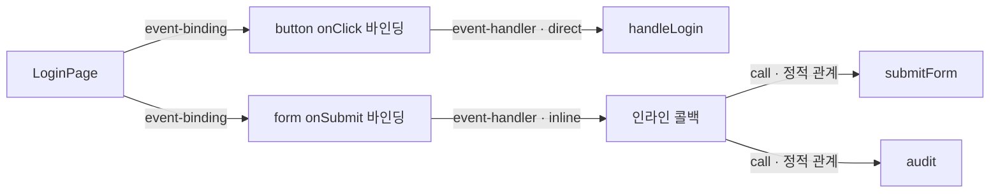

# React 이벤트 바인딩 분석 — 2단계 결과

작성일: 2026-11-09 (Asia/Seoul)

## 1. 추가·수정 파일

| 파일 | 변경 |
| --- | --- |
| src/types/analysis.ts | 선택적 reactEventBindings 필드와 ReactEventBinding/미해결 이유 타입 추가 |
| src/lib/ast/analyzer.ts | 기존 선언 ID·소유 함수 resolver로 이벤트 메타데이터 수집기를 호출 |
| src/lib/ast/reactEventBindings.ts | 추가: JSX 속성별 이벤트 사실 추출, 대상 선언 해석, 덮어쓰기·동적 값의 보수적 처리 |
| src/lib/ast/reactEventRules.ts | 추가: 지원 이벤트 및 알려진 intrinsic 요소의 순수 판정 규칙 |
| src/lib/ast/reactEventBindings.test.ts | 추가: 실제 TSX 입력에 대한 추출 회귀 테스트 30개 |
| src/types/behavior.ts | 이벤트 근거 origin, 바인딩 finding, 이벤트 연결 종류·옵션 및 정밀 위치 추가 |
| src/lib/behavior/evidenceMapper.ts | 바인딩 원문·태그·행/열·offset·선언을 근거로 매핑 |
| src/lib/behavior/flowBuilder.ts | 확인된 이벤트만 이벤트 단계로 투영, 일반 참조와 예산·기능 경계 유지 |
| src/lib/behavior/flowValidator.ts | 이벤트 근거·핸들러·양쪽 연결선·finding 검증 |
| src/lib/behavior/eventBindings.test.ts | 추가: 이벤트 투영, 기존 JSON 호환성, 위조 근거 거부 등 23개 테스트 |
| src/lib/behavior/fixtures/reactEvents.ts | 추가: 직접/인라인/조건부/컴포넌트 prop TSX 예제 |
| src/lib/behavior/flowBuilder.test.ts | 기존 1단계 투영 검증에 includeEvents:false를 명시하여 기존 계약 유지 |
| src/lib/behavior/flowValidator.test.ts | 원본 CodeEdge ID 위조 검증에서 실제 CodeEdge 근거가 있는 연결선을 선택 |
| docs/examples/behavior-react-events.json | 추가: 생성기를 실행한 실제 입력·이벤트 메타데이터·BehaviorFlow 출력 |
| docs/react-event-bindings-stage2.md | 추가: 이 보고서 |

UI·기존 그래프, GitHub 인증·권한, DB/API 구현, AI 생성, 기존 기능 분류 방식은 수정하지 않았다. 기존 CodeNode/CodeEdge 및 일반 FunctionRelation 생성 규칙도 유지했다. RepositoryAnalysis에는 이벤트 사실을 담는 선택적 메타데이터만 추가했으며 기존 API 핸들러나 엔드포인트는 변경하지 않았다.

## 2. 추출 방식

### 별도 이벤트 사실

기존 JSX reference는 함수가 전달됐다는 사실만 나타낸다. 새 수집기는 이미 분석 중인 동일 ts-morph Project에서 JSX opening/self-closing 요소와 그 속성을 직접 읽는다. 함수 이름에 handler/login 등이 포함됐다는 이유로 이벤트를 만들지 않는다.

ReactEventBinding에는 다음을 기록한다.

- 속성별 고유 ID: 파일 경로 + 정확한 시작/끝 offset. 같은 행의 동일 함수 바인딩도 서로 다르다.
- 이벤트 속성명, 지원되는 React 이벤트 종류와 bubble/capture 구분.
- JSX 태그 이름과 intrinsic/component/custom-element/namespaced/unknown 구분.
- 소유 함수 ID, 직접 함수 또는 인라인 콜백의 기존 AST 함수 ID.
- 파일·시작/끝 행·열·offset과 속성 전체의 정확한 원문, 원래 핸들러 표현식.
- mode(direct/inline/conditional/dynamic/none/spread), 대상 선언 확인 여부, 바인딩 status/confidence 및 미해결 이유.

offset과 열 번호는 TypeScript/JavaScript 문자열의 UTF-16 기준이다. 행·열은 1부터 시작하고 offset은 0부터, 끝 offset은 end-exclusive다. CRLF 및 한글/이모지 앞뒤의 위치도 테스트했다.

현재 지원 이벤트는 onClick/onSubmit/onChange와 각 Capture 변형이다. 알려진 HTML/SVG intrinsic 요소 목록에 대해서만 DOM 바인딩을 확정한다. 전체 React 이벤트·모든 DOM/SVG 요소를 지원한다고 주장하지 않는다. 목록 밖의 onX 속성은 unsupported-event/unsupported-element finding으로 남긴다.

### 직접 연결과 인라인 콜백

- 직접 함수 선언, const 함수 값, 확인 가능한 const 별칭·import는 기존 심벌/선언 resolver로 연결한다. 같은 이름의 서로 다른 지역 함수는 다른 ID로 유지한다.
- mutable 변수, 검출 가능한 함수 재대입, 호출 결과, bind 결과, 동적 프로퍼티/인덱스 값은 확인된 핸들러로 승격하지 않는다.
- 인라인 arrow/function expression은 기존 AST에 이미 존재하는 콜백 함수 ID를 대상으로 삼는다. 이벤트에서 콜백을 건너뛰어 내부 함수로 바로 연결하지 않는다.
- 콜백 내부의 기존 call 관계를 이후 탐색하되 호출끼리 순서를 잇지 않는다.
- event.preventDefault()는 일반 미해석 호출로 남을 수 있다. 기본 동작이 실제 차단됐다는 결과 노드나 제어 흐름을 만들지 않는다.

### 예외 처리

| TSX 형태 | 추출 결과 | 이벤트 단계 |
| --- | --- | --- |
| button onClick={handleLogin} | 지원 DOM + direct + 선언 확인이면 confirmed | 생성 |
| form onSubmit={(event) => { ... }} | 지원 DOM + inline callback 선언 확인 | 생성, 대상은 콜백 |
| input onChange={ready ? a : b} | conditional, inferred, target unresolved | 생성하지 않음 |
| onClick={ready && handler} 등 | 조건 표현식임을 기록, 분기를 선택하지 않음 | 생성하지 않음 |
| Button onClick={handler} | 대상 함수는 resolved일 수 있지만 DOM 바인딩은 component-prop/unresolved | 생성하지 않음 |
| Button action={handler} | 일반 JSX 참조 | 기존 reference 유지 |
| onClick={handlers[key]} / factory() / this.handler | dynamic/unresolved | 생성하지 않음 |
| let handler / 검출된 재대입 | dynamic-handler/unresolved | 생성하지 않음 |
| onClick={missing} | direct 문법이지만 target unresolved | 생성하지 않음 |
| onClick / 문자열 / null | missing-handler | 생성하지 않음 |
| custom-element, namespace, 알려지지 않은 태그 | custom-element/unsupported-element | 생성하지 않음 |
| 모듈 최상위 JSX | owner-unavailable | 페이지 소유를 추정하지 않음 |

조건부 표현식이라는 문법만 식별한다. 조건 값·참/거짓 경로·실제 실행 가능성을 분석하지 않는다. custom component 내부에 native button이 있더라도 호출부의 onClick prop이 그 DOM 속성으로 전달된다고 추정하지 않는다.

### 속성 순서와 spread

- onClick 뒤에 spread가 있으면 나중에 덮일 가능성이 있어 later-spread로 남긴다.
- 앞쪽 spread 뒤의 명시적인 onClick은 이후 다시 덮이지 않으면 확정할 수 있다.
- 같은 이벤트 속성이 뒤에 다시 있으면 앞 속성은 overridden-attribute다.
- spread 자체는 eventName=* / spread-properties로 남긴다. spread에 특정 이벤트가 있다고 가정하지 않는다. 정적인 객체 spread의 내용을 추가 해석하지도 않는다.

## 3. 기존 중복 병합 문제와 최소 변경

기존 일반 참조는 relation/target/line 등을 기준으로 합쳐진다. 예를 들어 한 행의 onClick={handler}, onChange={handler}, onSubmit={handler}가 하나의 reference로 남을 수 있다.

이 문제를 해결하려고 기존 그래프 연결선 ID나 전역 중복 제거 규칙을 바꾸지 않았다. 대신 이벤트마다 정확한 속성 offset으로 식별되는 독립 ReactEventBinding을 보존한다. 새 BehaviorFlow의 이벤트 근거는 이 원본 AST 사실을 가리키며, 존재하지 않는 CodeEdge ID를 만들지 않는다. 이벤트 연결선의 sourceEdgeIds가 비어 있는 것은 이러한 독립 근거를 사용하기 때문이며, sourceNodeIds와 event-binding origin은 실제 선언/코드에 연결된다.

3개 이벤트가 하나의 기존 reference로 합쳐져도 새 이벤트 노드 3개와 각각의 바인딩 근거가 유지되는 테스트를 추가했다.

일반 reference를 이벤트 두 단계로 대체할 때도 주의한다. 같은 행에 button onClick={handler}와 Button onClick={handler}가 있으면 기존 reference의 문자열·행이 같아 어느 쪽인지 구별되지 않을 수 있다. 모든 일치 속성이 실제로 이벤트 투영된 경우에만 해당 generic reference를 대체한다. 미해결 컴포넌트 prop이나 예산으로 제외된 속성이 함께 있으면 reference도 유지한다.

## 4. BehaviorFlow 연결 및 호환성

기본적으로 이벤트 메타데이터가 있으면 새 투영을 사용한다.

```ts
const flow = buildBehaviorFlow(analysis, entryPoint);
const all = buildBehaviorFlows(analysis);

// 1단계의 일반 참조 중심 투영이 필요한 호출자
const legacy = buildBehaviorFlow(analysis, entryPoint, { includeEvents: false });
```

이벤트 메타데이터가 없는 기존 분석/캐시 입력은 원래 참조 흐름으로 동작한다. 과거 캐시에서 바인딩 정보를 추측해 복원하지 않는다. 새 추출 결과를 사용하려면 해당 입력을 다시 분석해야 한다. 이번 단계에서는 API 캐시나 권한 경계를 변경하지 않았다.

schemaVersion=1은 유지하고 기존에 예약돼 있던 event 노드를 실제 근거가 있을 때만 사용한다. 추가 필드는 선택적이다. 1단계 JSON을 덮어쓰지 않았으며, 해당 과거 출력이 새 validator에서도 유효함을 테스트했다.

확정된 바인딩은 다음 관계로 표현한다.

- 소유 페이지/함수 → 이벤트 위치: event-binding
- 이벤트 위치 → 실제 핸들러 또는 인라인 콜백: event-handler
- 인라인 콜백 → 내부 함수: 원래의 call 관계

모든 연결선의 semantics는 static-relation이고 executionOrder는 not-established다. 이벤트 노드의 이름도 `<button> onClick 바인딩`처럼 코드 의미만 나타낸다. 실제 사용자가 클릭했다거나 handler가 실행됐다고 표현하지 않는다.

BehaviorFlow.eventBindings에는 projected/unresolved/excluded findings를 남긴다. AST confidence는 보존한다. source 범위, 이벤트 종류, 태그 분류, 기존 선언, 바인딩 ID, 근거·연결의 양쪽 참조를 검증한다. 예산을 넘을 때는 이벤트와 핸들러 연결을 함께 제외하여 반쪽 이벤트 단계를 만들지 않는다. 다른 기능의 진입점 경계도 유지한다.

## 5. 실제 입력과 출력

전체 실제 입력·추출 사실·출력은 [behavior-react-events.json](examples/behavior-react-events.json)에 있다. 이 JSON은 생성기를 실행하고 validator가 통과한 결과를 저장한 것이다.

입력 핵심 부분:

```tsx
function handleLogin() { return 1; }
function submitForm() { return 2; }
function audit() { return 3; }
function Button(props: { onClick: () => void }) {
  return <button onClick={props.onClick}/>;
}
export default function LoginPage() {
  const ready = Boolean(Date.now());
  return <>
    <button onClick={handleLogin}>Sign in</button>
    <form onSubmit={(event) => {
      event.preventDefault();
      submitForm();
      audit();
    }}/>
    <input onChange={ready ? handleLogin : submitForm}/>
    <Button onClick={handleLogin}/>
  </>;
}
```

확정 바인딩과 콜백 호출 부분만 발췌한 정적 관계:



submitForm → audit 실행 순서를 생성하지 않는다. 그림에 없는 일반 컴포넌트/참조·미해결 관계는 전체 JSON에 있다.

실제 JSON 결과:

- AST 바인딩 사실 5개, 이벤트 노드 2개.
- 전체 노드 8개, 정적 연결 9개, status=partial.
- onClick 직접 연결과 onSubmit 인라인 콜백만 projected.
- 조건부 onChange, Button 호출부 onClick prop, Button 내부 props.onClick은 각각 conditional-handler/component-prop/dynamic-handler로 남는다.
- 원본 JSON의 직접 onClick 근거는 app/login/page.tsx:8이다. 위 가독성용 코드는 Button 정의를 여러 행으로 펼쳤으므로 줄 번호는 원본 JSON을 기준으로 한다.

## 6. 직접 연결·추정·미해결 구분

- **confirmed + resolved**: 지원 DOM 속성과 실제 함수/콜백 선언이 확인됐으며, 뒤 속성에 의해 덮이는 것으로 판단되지 않는 정적 바인딩이다. 런타임 실행이나 마운트 여부의 보장이 아니다.
- **inferred + unresolved**: 조건부 핸들러 등 선택이 필요한 표현식이다. 어느 함수를 택할지 추론하지 않으며 이벤트 단계를 만들지 않는다.
- **unknown + unresolved**: 동적 값, 지원 밖 이벤트/태그, 미해석 대상, custom props, spread 등이다. targetResolution=resolved여도 DOM 바인딩 status가 unresolved이면 이벤트 단계를 만들지 않는다.
- 일반 JSX reference의 confirmed는 함수 참조 존재에 관한 것이다. 이를 DOM 이벤트 연결 확인과 혼동하지 않는다.

## 7. 검증

신규 테스트는 실제 TSX 문자열을 기존 analyzeSourceFiles로 분석한다. 코드가 실행되거나 브라우저 클릭이 발생한 테스트가 아니다. 실제 로컬 RepoTutor의 FeaturePicker.tsx와 repository/page.tsx 일부도 분석했다. 네트워크·DB·AI 서비스 호출은 없다.

검증 범위:

- 클릭·submit·change 직접 연결, capture, 인라인 arrow/function expression.
- 조건·논리식·동적/누락/비함수 대상, const 별칭/import, 이름 shadowing과 mutable 값.
- 컴포넌트/custom element/namespace/지원 밖 이벤트 구분, 일반 props 참조 유지.
- 같은 행·같은 함수의 여러 이벤트 위치 보존, 뒤 spread/중복 속성의 영향.
- 콜백 안의 여러 호출을 fan-out 정적 관계로 유지, preventDefault·분기·DB·결과 노드 추정 금지.
- 원문·행/열/offset, 위조된 이벤트명·핸들러·근거·finding·실행 순서 거부.
- frozen 입력 불변성, 탐색 예산, 1단계 JSON/기존 AST·BehaviorFlow와의 호환성.

| 최종 검증 | 결과 |
| --- | --- |
| npm.cmd run typecheck | 통과 |
| npm.cmd run lint | 통과, 경고·오류 없음 |
| npm.cmd test -- --maxWorkers=2 | 35개 파일, 421개 테스트 통과; 기존 4개 파일/5개 테스트 건너뜀 |
| 신규 이벤트 회귀 테스트 | 위 결과에 포함: AST 추출 30개, BehaviorFlow·호환성·검증 23개, 합계 53개 |
| npm.cmd run build | 통과, 컴파일·타입 검사·페이지 생성 완료 |
| git diff --check | 통과 |

전체 테스트는 기존 AST 테스트의 자원 경합을 피하려고 --maxWorkers=2로 실행했으며 제한 시간 설정은 변경하지 않았다. 건너뛴 5개는 기존 외부 연동 테스트 설정에 따른 결과로, 실제 GitHub·운영 DB·AI E2E를 검증했다는 의미가 아니다.

테스트와 빌드는 하위 프로세스 실행을 허용한 환경에서 npm.cmd로 실행했다. 예제 생성에 사용한 임시 테스트는 검증 후 제거했고 최종 53개 테스트 수에 포함하지 않았다. 자동 변경된 next-env.d.ts 및 tsconfig.tsbuildinfo는 작업 시작 상태로 복구했다.

## 8. 남은 한계와 다음 제어 흐름 단계

- 지금 확인하는 것은 JSX 속성의 정적 연결이다. 실제 렌더링/마운트, disabled 상태, 이벤트 발생·전파·기본 동작, React 런타임의 호출 순서나 횟수를 증명하지 않는다.
- 사용자 정의 컴포넌트의 prop → parameter → 내부 DOM 속성 전달은 아직 연결하지 않는다. 원본 선언/인자/prop 근거를 가진 별도 데이터 전달 분석이 필요하다.
- this.handler, 동적 프로퍼티, 팩토리/bind/useCallback/useMemo 반환값 등 기존 resolver가 함수 값으로 확정하지 못한 경우는 미해결이다. 객체의 불변성이나 모든 런타임 재대입을 증명하지 않는다.
- 이벤트 목록과 intrinsic 목록은 보수적인 부분집합이다. 확장 시 실제 React 이벤트/요소 규칙과 별도 회귀 사례를 추가해야 한다.
- 모듈 수준 JSX나 다른 함수에서 만들어져 전달되는 JSX의 최종 소유 화면은 추측하지 않는다.
- 분석 결과의 optional metadata와 기존 파일 원문을 신뢰하는 provenance 검증이다. 임의 외부 JSON에 대한 완전한 런타임 스키마 검증기나 AST 심벌 해석의 독립 증명기는 아니다.

다음 단계에서는 우선 함수 내부 statement의 정밀 source range와 if/switch/조기 return/throw/try/loop 경로를 구조화해야 한다. 그 뒤 콜백 안의 call site가 어느 조건·분기·예외 경로에 있는지 기록할 수 있다. 배열이나 줄 번호 순서로 함수 간 실행 순서를 만드는 방식은 사용하면 안 된다.

await/Promise/이벤트 scheduling은 별도 의미 계층으로 다뤄야 한다. 정적으로 가능한 제어 흐름과 실제 관측된 실행 순서를 구분하고, callback forwarding 및 반환 함수의 값 추적은 각각의 근거가 있을 때만 확장한다. 이번 단계에는 조건 분기·DB 분석·런타임 실행 순서 추론을 추가하지 않았다.
